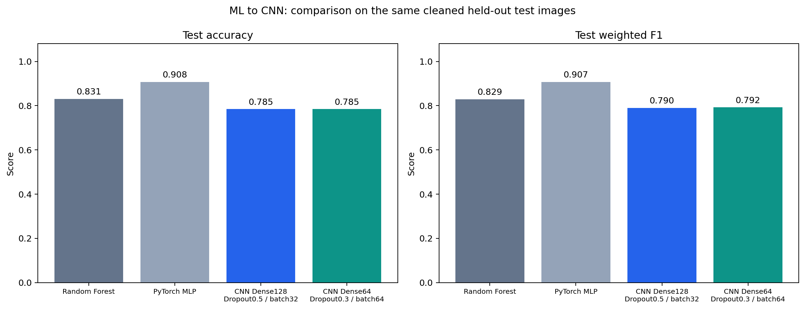

# Part C - Final Summary and Reflection

This reflection uses the latest saved Part A and Part B results for the three-class COVID-19 image classification task. Part B includes training-only augmentation, a maximum of 40 epochs, and early-stopping patience of 8. The objective was to progress from ML baselines to CNNs and evaluate whether the additional spatial modelling improved performance.

## C.1 - Master Results Table

All four models were evaluated on the **same 65 unique test images**: 25 Covid, 20 Normal, and 20 Viral Pneumonia images. Accuracy is the primary metric; weighted F1 and CNN cross-entropy loss provide secondary measures.

| Model type | Model | Test accuracy | Weighted F1 | Test cross-entropy loss |
|---|---|---:|---:|---:|
| Part A: ML baseline | Random Forest, 300 trees | 83.08% | 0.8292 | Not recorded |
| Part A: ML baseline | PyTorch MLP, hidden layers (128, 64) | **90.77%** | **0.9073** | Not recorded |
| Part B: Deep Learning 1 | CNN, Dense 128 / Dropout 0.5 / batch 32 | 78.46% | 0.7900 | **0.4893** |
| Part B: Deep Learning 2 | CNN, Dense 64 / Dropout 0.3 / batch 64 | 78.46% | 0.7920 | 0.5066 |

The MLP is itself a fully connected neural network. It is grouped with the Part A baselines to follow the assignment's organisation. Missing ML loss values mean that loss was not recorded; they do not represent zero loss.

### Training and model-selection context

Part A used flattened 64 x 64 grayscale images and fold-specific `StandardScaler` fitting. Five-fold stratified CV was performed on the cleaned training set, and the final models were refitted on all **242 training images**. Random Forest achieved mean CV accuracy **91.72%**, with a fold standard deviation of **2.15 percentage points**. The MLP achieved **94.62%**, with a standard deviation of **3.18 percentage points**, and was selected as the Part A baseline before test evaluation.

Part B used 128 x 128 grayscale tensors scaled to [0, 1], with **193 fitting images and 49 validation images**. Both CNNs reached **93.88% validation accuracy**. The Dense128 CNN was selected because its checkpoint validation loss was **0.3250**, compared with **0.3375** for Dense64. This decision was based on validation results, even though Dense64 later obtained a slightly higher test weighted F1.

| CNN configuration | Trainable parameters | Epochs executed | Restored epoch |
|---|---:|---:|---:|
| Dense 128 / Dropout 0.5 / batch 32 | 3,304,451 | 12 | 12 |
| Dense 64 / Dropout 0.3 / batch 64 | 1,698,563 | 28 | 21 |

Early stopping counted epochs without a **strict increase in validation accuracy**. A tied accuracy with lower loss could update the checkpoint without resetting patience. Therefore, the restored epoch need not be the first epoch that achieved the best accuracy.

The CV and holdout-validation scores use different evaluation protocols. They should not be treated as equivalent estimates. The shared test set supports a descriptive comparison, but different fitting-set sizes, image resolutions, and preprocessing prevent an isolated comparison of architecture alone.

Evidence: [Part A results](artifacts/part_a/tables/model_comparison.csv), [Part B results](artifacts/part_b/tables/cnn_comparison.csv), and [combined results](artifacts/part_b/tables/ml_cnn_comparison.csv).

## C.2 - Identify the Best Model

### Which model performed best?

The **PyTorch MLP (128, 64)** performed best overall in this experiment. It correctly classified **59 of 65 images**, compared with 54 for Random Forest and 51 for each CNN. Its accuracy exceeded the selected CNN by **12.31 percentage points**, equivalent to eight additional correct predictions. It also had the highest weighted F1 and macro F1, **0.9073** and **0.9062**, respectively.

The **Dense128 CNN remains the selected Deep Learning model** under the validation-based selection rule. It is the CNN checkpoint to carry forward for further development, while the MLP remains the strongest measured reference model.

### Why might the MLP have performed better?

A plausible explanation is that the MLP's standardised, lower-resolution representation and smaller parameter count were easier to fit with limited data. It has **532,867 parameters**, compared with approximately 1.70 million and 3.30 million for the CNNs. The MLP also used all 242 training images in its final fit, whereas the CNNs reserved 49 images for validation. These are possible contributors, rather than demonstrated causes.

The selected CNN's main weakness was distinguishing Normal from Viral Pneumonia: **11 of its 14 errors** were confusions between those classes. Its recall was 0.70 for Normal and 0.75 for Viral Pneumonia, compared with 0.95 and 0.85 for the MLP. Although its Covid precision was 1.00, its Covid recall was 0.88, meaning that three of the 25 Covid images were misclassified. A strong result for one metric or class does not establish better overall performance. These observations come from the [MLP report](artifacts/part_a/tables/pytorch_mlp_classification_report.csv), [CNN report](artifacts/part_b/tables/cnn_dense128_dropout05_classification_report.csv), and saved predictions.

### Would I deploy the best model in production?

I would retain these models as experimental prototypes rather than deploy them for patient-facing decisions. The highest score comes from only 65 test images; one changed prediction moves accuracy by approximately **1.54 percentage points**. Removing exact duplicates improved split integrity, but patient independence and performance on images from other sources have not been established. Probability calibration and production workflow performance were also not evaluated.

Both Part A models achieved 100% training accuracy, which further cautions against assuming that their test ranking guarantees generalisation. Before considering deployment, I would obtain independent patient-level evaluation data, investigate class-specific errors, assess probability calibration, and evaluate the intended workflow. Softmax confidence alone would not substitute for a calibration assessment. See the [scikit-learn calibration documentation](https://scikit-learn.org/stable/modules/calibration.html).

## C.3 - Reflection Questions

### How did the CNN architecture choices affect performance?

Both CNNs used three convolutional blocks with **32, 64, and 128 filters**, 3 x 3 kernels, ReLU activations, and 2 x 2 max pooling. This structure learns local spatial features while progressively reducing the image dimensions. The final feature map was 128 x 14 x 14, producing **25,088 features after Flatten**.

Flattening created a large classification head: approximately **97.20%** of the Dense128 model's parameters and **94.54%** of Dense64's parameters were in the classifier. This is a substantial capacity relative to 193 fitting images and is a plausible generalisation concern. It does not prove that the head caused the lower test scores.

The wider head used stronger Dropout, while the narrower head used weaker Dropout and a larger batch. Both reached the same validation and test accuracies, but differed in loss, weighted F1, and class-level errors. Because Dense width, Dropout, and batch size changed together, I cannot attribute those differences to one setting. A controlled experiment would vary one factor at a time.

The [learning curves](artifacts/part_b/figures/training_validation_curves.png) show that both models learned, but validation performance fluctuated. Training accuracy was measured with augmentation and Dropout active; validation used deterministic images with Dropout disabled. Consequently, validation accuracy exceeding training accuracy is not by itself evidence of leakage or evidence that overfitting is absent.

### Did Deep Learning outperform the Part A models?

**No.** In the final experiment, both CNNs achieved 78.46% test accuracy, below Random Forest's 83.08% and the MLP's 90.77%. The CNNs' ability to learn spatial features did not translate into better test performance under these settings.

Limited fitting data, model capacity, optimisation, resolution, and augmentation may all contribute. Training augmentation included horizontal flips, rotations of up to 10 degrees, and brightness/saturation jitter of 20%; validation and test images were not augmented. Saturation has little effect on already monochrome images. The current results do not establish that augmentation or any individual architectural choice caused the performance gap.

These experiments show why moving towards a CNN should include a measured comparison with simpler baselines. The CNN remains the intended development direction, supported by an explicit record of where its present performance needs improvement.

### What would I improve with more time?

1. **Strengthen the evaluation design.** I would collect patient identifiers and additional images, group related images within the same split, and use repeated or nested validation on the development data. The same test set was inspected across several configuration revisions, so I would reserve a fresh, untouched final test set for confirmation. I would also align fitting-data budgets when comparing model families. The [scikit-learn cross-validation guide](https://scikit-learn.org/stable/modules/cross_validation.html) provides the relevant validation and grouping methods.

2. **Investigate transfer learning and a smaller head.** I would compare a pretrained CNN with the models trained from scratch, first training a replacement classifier and then testing limited fine-tuning. I would also compare global average pooling with the current Flatten head to reduce parameter count. The [official PyTorch transfer-learning tutorial](https://docs.pytorch.org/tutorials/beginner/transfer_learning_tutorial.html) provides a starting workflow; any benefit would need to be measured on this dataset.

3. **Run controlled training experiments.** I would vary Dense width, Dropout, batch size, learning rate, and augmentation strength separately, using multiple seeds and validation results. I would compare no augmentation, geometric augmentation, and brightness augmentation, and inspect whether the transformations preserve useful image information. The 40-epoch cap and patience 8 would be revisited through validation rather than through test-score feedback.

4. **Focus on class-specific errors.** I would inspect the Normal/Viral Pneumonia confusions, image quality, labels, near-duplicates, and source-specific visual cues. I would track macro F1 and per-class recall alongside weighted F1, then assess calibration and inference performance for any promising candidate.

The complete results and configuration are reproducible from [PortfolioTask3.ipynb](PortfolioTask3.ipynb), the [Part A configuration](artifacts/part_a/experiment_config.json), and the [Part B configuration](artifacts/part_b/experiment_config.json).
